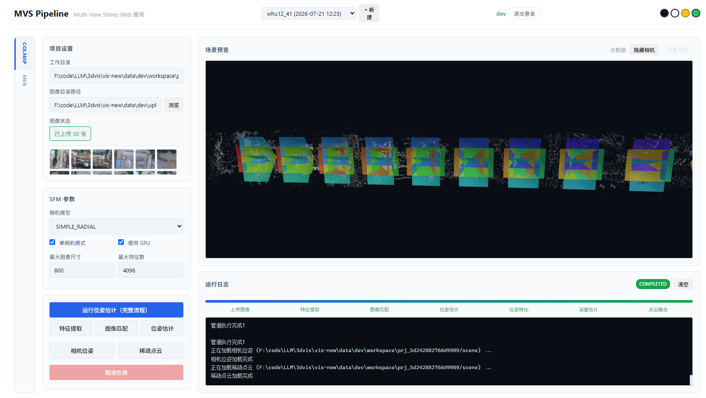
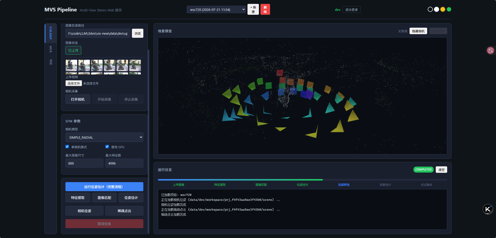

# MVS Pipeline Web Service

A web-based multi-view stereo (MVS) pipeline service integrating COLMAP for pose estimation and multiple MVS methods for depth estimation and point cloud fusion.

## Features

- **Multi-user system** with isolated data storage
- **Project management** with automatic configuration persistence
- **Image upload** with batch upload support and preview
- **COLMAP integration** for feature extraction, matching, pose estimation, and format conversion
- **MVS pipeline** supporting CasMVSNet, UniMVSNet, and MVSTER
- **3D visualization** of camera poses, sparse point clouds, and dense point clouds
- **Point cloud processing** with Open3D (voxel downsampling, statistical filtering, radius filtering)
- **Video input** with frame extraction
- **Camera capture** from browser
- **Real-time progress** tracking via WebSocket

## Results

<div align="center">
  
  
  <p><em>Left: Camera pose visualization. Right: Dense point cloud result.</em></p>
</div>

## Architecture

```
vis-new/
├── backend/                  # FastAPI backend
│   ├── api/                  # Route handlers
│   ├── services/             # Background task manager
│   ├── auth.py               # JWT authentication
│   ├── db.py                 # User database
│   ├── main.py               # Application entry point
│   ├── mvs_depth.py          # CasMVSNet integration
│   ├── mvs_unimvsnet.py      # UniMVSNet integration
│   ├── mvs_mvster.py         # MVSTER integration
│   ├── mvsnet_converter.py   # COLMAP format converter
│   ├── pipeline_core.py      # Pipeline orchestration
│   └── pointcloud_ops.py     # Open3D point cloud operations
├── frontend/                 # Web frontend
│   ├── css/style.css
│   ├── js/app.js
│   ├── js/three-viewer.js
│   └── index.html
├── MVS/                      # MVS method directories
│   ├── CasMVSNet_eval/
│   ├── UniMVSNet_eval/
│   ├── MVSTER_eval/
│   └── shared/datasets/      # Shared dataset module
└── docs/                     # Documentation
```

## Quick Start

### Prerequisites

- Python 3.8+
- PyTorch (for MVS methods)
- pycolmap (for COLMAP integration)
- Open3D (for point cloud processing)

### Installation

```bash
pip install -r backend/requirements.txt
```

### Running the Server

```bash
python -m uvicorn backend.main:app --host 127.0.0.1 --port 8005 --reload
```

Open `http://127.0.0.1:8005` in your browser.

Default development account:
- Username: `dev`
- Password: `dev`

## Usage

### COLMAP Pose Estimation

1. Select the **COLMAP** tab
2. Upload images or specify an image directory
3. Click **Run Pose Estimation**
4. View camera poses or sparse point cloud

### MVS Depth Estimation

1. Select the **MVS** tab
2. Choose an MVS method and checkpoint
3. Click **Convert** → **Depth Estimation** → **Point Cloud Fusion**
4. View the dense point cloud in the 3D viewer

### Point Cloud Processing

1. Select the **Point Cloud** tab
2. Choose a depth estimation source
3. Configure parameters and run fusion or filtering

## API Endpoints

### Authentication
- `POST /api/auth/register` - Register
- `POST /api/auth/login` - Login
- `GET /api/auth/me` - Current user

### Project Management
- `POST /api/projects/create` - Create project
- `GET /api/projects` - List projects
- `GET /api/projects/{id}` - Get project
- `PUT /api/projects/{id}` - Update project

### Pipeline
- `POST /api/pipeline/run` - Run pipeline
- `GET /api/pipeline/status/{id}` - Get status
- `POST /api/pipeline/cancel/{id}` - Cancel task

### File Management
- `POST /api/files/upload/images` - Upload images
- `GET /api/files/cameras` - Camera poses
- `GET /api/files/sparse_ply` - Sparse point cloud
- `GET /api/files/ply` - Dense point cloud

## License

MIT