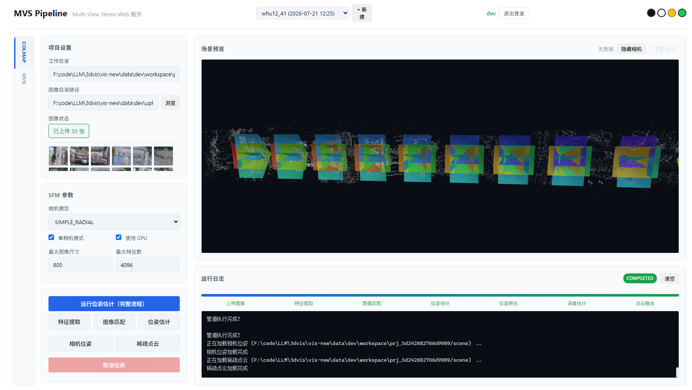
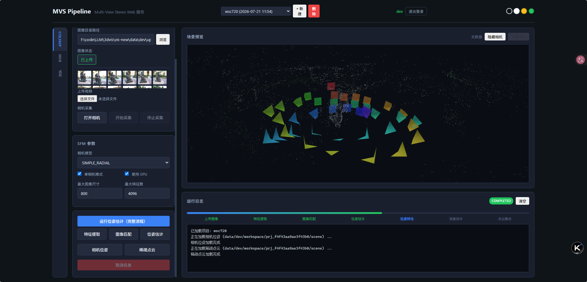

# MVS Pipeline Web 服务

基于 Web 的多视角立体视觉（MVS）管道服务，集成了 COLMAP 位姿估计和多种 MVS 深度估计方法。

## 功能特性

- **多用户系统**，数据独立隔离
- **项目管理**，自动保存配置和日志
- **图像/视频输入**，支持批量上传、帧提取、相机采集
- **COLMAP 集成**：特征提取、图像匹配、位姿估计、格式转换
- **MVS 管道**：支持 CasMVSNet、UniMVSNet、MVSTER
- **3D 可视化**：相机位姿、稀疏点云、稠密点云
- **点云后处理**：体素下采样、统计滤波、半径滤波
- **实时进度追踪**（WebSocket）

## 结果展示

<div align="center">
  
  
  <p><em>左：相机位姿可视化。右：稠密点云结果。</em></p>
</div>

## 项目结构

```
vis-new/
├── backend/                  # FastAPI 后端
│   ├── api/                  # API 路由
│   ├── services/             # 后台任务管理
│   ├── auth.py               # JWT 认证
│   ├── db.py                 # 用户数据库
│   ├── main.py               # 应用入口
│   ├── mvs_depth.py          # CasMVSNet 集成
│   ├── mvs_unimvsnet.py      # UniMVSNet 集成
│   ├── mvs_mvster.py         # MVSTER 集成
│   ├── mvsnet_converter.py   # COLMAP 格式转换
│   ├── pipeline_core.py      # 管道编排
│   └── pointcloud_ops.py     # Open3D 点云处理
├── frontend/                 # 前端
│   ├── css/style.css
│   ├── js/app.js
│   ├── js/three-viewer.js
│   └── index.html
├── MVS/                      # MVS 方法目录
│   ├── CasMVSNet_eval/
│   ├── UniMVSNet_eval/
│   ├── MVSTER_eval/
│   └── shared/datasets/      # 共享数据集模块
└── docs/                     # 文档
```

## 快速开始

### 环境要求

- Python 3.8+
- PyTorch（MVS 方法需要）
- pycolmap（COLMAP 集成需要）
- Open3D（点云处理需要）

### 安装依赖

```bash
pip install -r backend/requirements.txt
```

### 启动服务

```bash
python -m uvicorn backend.main:app --host 127.0.0.1 --port 8005 --reload
```

浏览器访问 `http://127.0.0.1:8005`

默认开发账号：
- 用户名：`dev`
- 密码：`dev`

## 使用说明

### COLMAP 位姿估计

1. 选择「COLMAP」标签
2. 上传图像或指定图像目录
3. 点击「运行位姿估计」
4. 完成后可查看「相机位姿」或「稀疏点云」

### MVS 深度估计

1. 选择「MVS」标签
2. 选择 MVS 方法和 checkpoint
3. 点击「格式转换」→「深度估计」→「点云融合」
4. 在 3D 视图中查看稠密点云

### 点云处理

1. 选择「点云」标签
2. 选择深度估计来源
3. 配置参数，运行融合或滤波

## API 接口

### 认证
- `POST /api/auth/register` - 注册
- `POST /api/auth/login` - 登录
- `GET /api/auth/me` - 当前用户

### 项目管理
- `POST /api/projects/create` - 创建项目
- `GET /api/projects` - 列出项目
- `GET /api/projects/{id}` - 获取项目
- `PUT /api/projects/{id}` - 更新项目

### 管道执行
- `POST /api/pipeline/run` - 运行管道
- `GET /api/pipeline/status/{id}` - 查询状态
- `POST /api/pipeline/cancel/{id}` - 取消任务

### 文件管理
- `POST /api/files/upload/images` - 上传图像
- `GET /api/files/cameras` - 相机位姿
- `GET /api/files/sparse_ply` - 稀疏点云
- `GET /api/files/ply` - 稠密点云

## 许可证

MIT