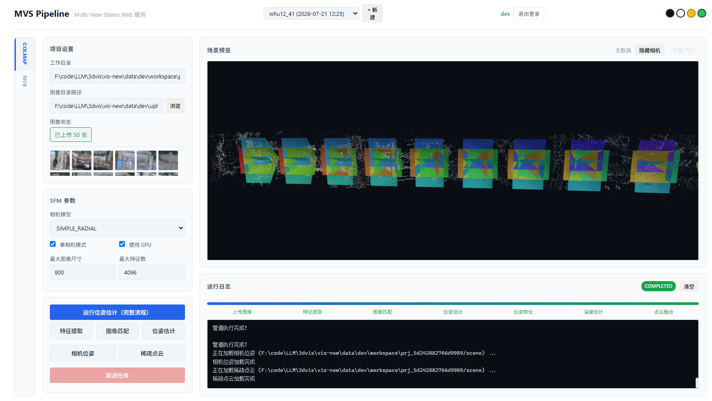
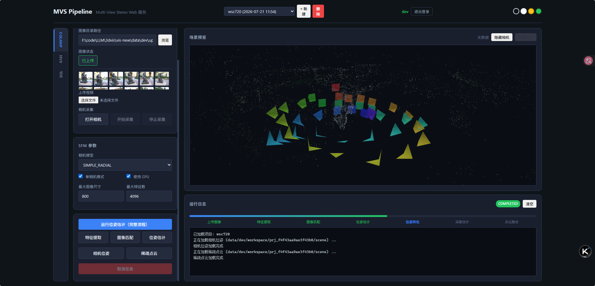

# MVS Pipeline Web Service

A web-based multi-view stereo (MVS) pipeline service.

## Getting Started

- [Installation Guide](guide/installation.md)
- [Quick Start](guide/quickstart.md)
- [API Reference](api/endpoints.md)

## Features

- **Multi-user system** with isolated data storage
- **Project management** with automatic configuration persistence
- **COLMAP integration** for pose estimation
- **Multiple MVS methods**: CasMVSNet, UniMVSNet, MVSTER
- **3D visualization** of camera poses and point clouds
- **Point cloud processing** with Open3D

## Results

<div align="center">
  
  
  <p><em>Left: Camera pose visualization. Right: Dense point cloud result.</em></p>
</div>

## Project Structure

```
vis-new/
├── backend/          # FastAPI backend
├── frontend/         # Web frontend (HTML/CSS/JS)
├── MVS/              # MVS method directories
└── docs/             # Documentation
```

## License

MIT